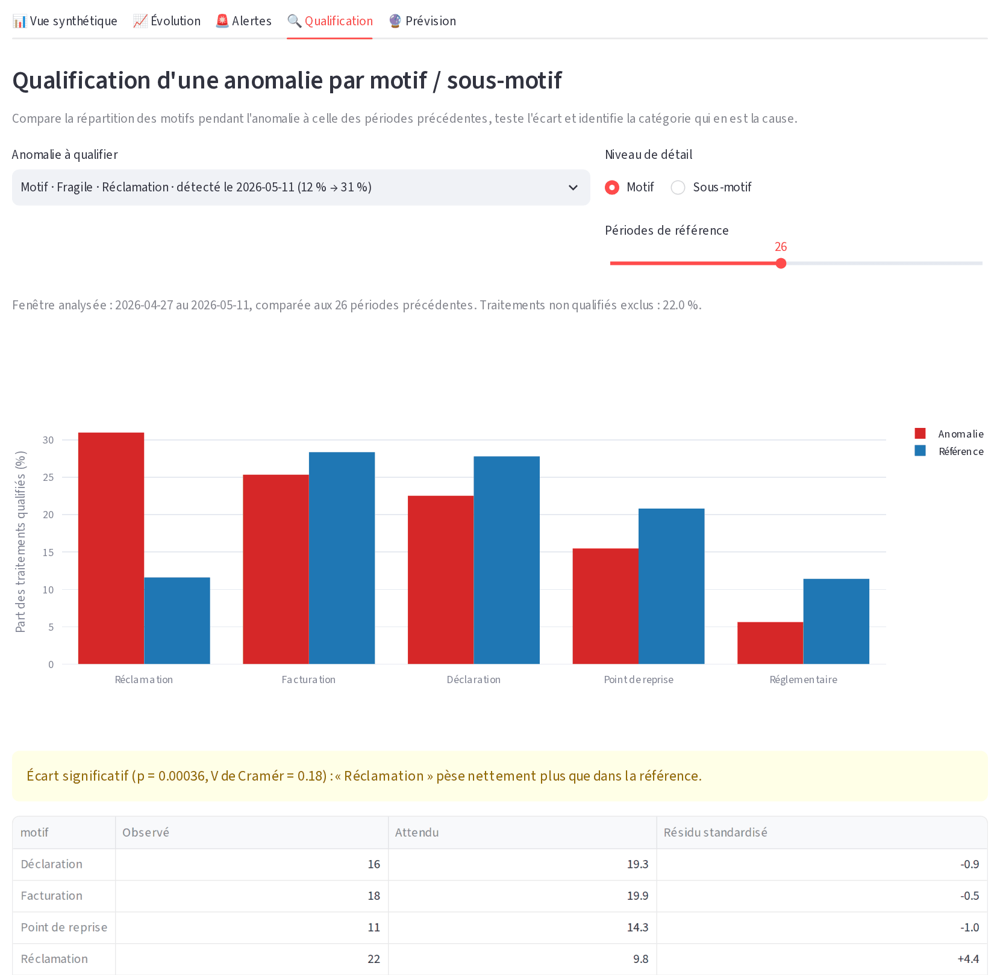
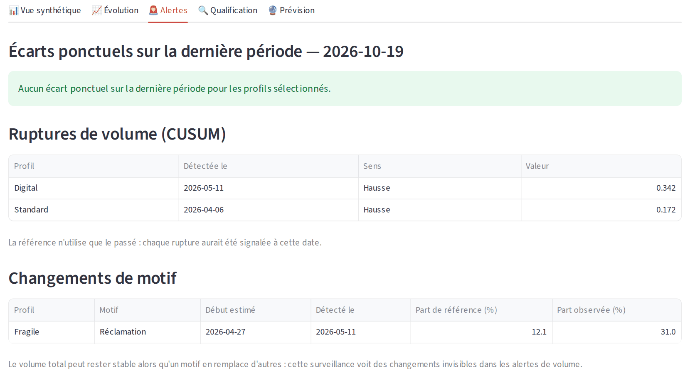

# Pilotage du taux d'appel par profil client

Application Streamlit qui suit les sollicitations (appels et emails) par profil de
compte, détecte les écarts, identifie le motif qui les explique et prévoit la charge.

Projet réalisé seul pour mon mémoire de fin d'études (Mastère IA & Management, IA
School, 2026). Il se complète avec [staffing](https://github.com/Jerome-Servais/staffing),
qui transforme une prévision d'appels en effectif à planifier.

Ce dépôt ne contient **aucune donnée réelle**. Les résultats ci-dessous viennent de
données simulées où les anomalies sont injectées à une date connue : ils décrivent le
comportement de la méthode, pas celui d'un service client réel.



## Résultats

Reproductibles avec `python evaluate.py --all-models` (environ 9 minutes). Un tableau
de bord ne montre pas ses fausses alertes ni son délai de détection : l'évaluation les
mesure sur 300 simulations par scénario.

### Une rupture durable est détectée en quelques semaines

Suivi hebdomadaire, sur 18 mois, avec une rupture à une date connue.

| Scénario | CUSUM : alertes par an avant la rupture | CUSUM : rupture détectée | Délai médian | Z-score : alertes par an avant la rupture |
|---|---:|---:|---:|---:|
| Aucune rupture, tous canaux | 0,4 | 16,3 % | – | 3,7 |
| Appels +15 %, tous canaux | 0,3 | 91,3 % | 4,3 sem. | 3,7 |
| Appels +50 %, tous canaux, profil à dominante email | 0,4 | 83,0 % | 5,3 sem. | 3,8 |
| Appels ×4,2, tous canaux, même profil | 0,4 | 96,3 % | 2,3 sem. | 3,9 |
| Appels ×4,2, vue appels seule | 0,0 | 100 % | 1,3 sem. | 0,1 |

- **Ligne « Aucune rupture »** : elle donne le niveau de référence. Le CUSUM y signale
  une rupture inexistante dans 16,3 % des simulations, sur les 6 mois suivants.
- **Z-score** : il répond à une autre question. Il réagit à chaque pic ponctuel, comme
  les environ 4 campagnes email simulées par an, d'où ses 3,7 alertes par an. Sur la
  vue appels, sans campagne, il tombe à 0,1 alerte par an. Son taux de détection tous
  canaux n'est pas interprétable : 92 % sans aucune rupture.
- **Isoler le canal** divise le délai par près de deux : mélanger appels et emails dilue
  le signal.
- **Le suivi mensuel n'est pas adapté aux hausses modérées** : le CUSUM ne détecte alors
  que 29,7 % des hausses de 15 % et 39,0 % des hausses de 50 %, avec un délai médian de
  13 semaines.

### Un changement de motif est visible sans hausse de volume

Si les réclamations remplacent d'autres demandes, le volume total ne bouge pas et aucune
alerte de volume ne se déclenche. La surveillance de la part de chaque motif comble ce
manque, ici pour une part de réclamations multipliée par 3,5 et 22 traitements par
semaine.

| Fausses alertes par an et par profil | Changement détecté | Délai médian |
|---:|---:|---:|
| 0,2 | 99,7 % | 2 semaines |

Le test du chi² compare ensuite la période d'anomalie à une référence antérieure, puis
le résidu standardisé nomme le motif en cause.



### Les intervalles comptent autant que l'erreur moyenne

Huit modèles et une référence simple, en validation glissante (8 replis). Volume global,
sur une série qui contient la rupture injectée. La couverture devrait approcher 95 %.

| Modèle | Semaine (12 périodes) : WAPE | Couverture | Jour (28 périodes) : WAPE | Couverture |
|---|---:|---:|---:|---:|
| Référence (médiane récente) | 7,8 % | 69,8 % | 7,1 % | 92,0 % |
| Régression linéaire | 7,1 % | 70,8 % | 7,2 % | 97,8 % |
| SARIMA | 6,6 % | 77,1 % | 7,7 % | 98,2 % |
| Prophet | 7,0 % | 71,9 % | 8,0 % | 97,8 % |
| XGBoost (Poisson) | 9,5 % | 87,5 % | 11,7 % | 95,1 % |
| GLM Poisson | 7,1 % | 46,9 % | 7,0 % | 87,5 % |
| **GLM Binomiale négative** | 7,1 % | 72,9 % | 7,0 % | 97,8 % |
| Bayésien Poisson (PyMC) | 7,1 % | 49,0 % | 7,0 % | 87,1 % |
| Bayésien Binomiale négative (PyMC) | 7,0 % | 90,6 % | 6,9 % | 98,7 % |

- **Poisson est trop confiant** : à erreur égale, ses intervalles couvrent 87,5 % du réel
  en journalier, contre 97,8 % pour la Binomiale négative. Celle-ci est le modèle par
  défaut de l'application.
- **Les modèles complexes gagnent peu ici** : en journalier, le WAPE passe de 7,1 % pour
  la référence à 6,9 % au mieux. Sur le profil Standard, sans
  rupture, la référence bat même tous les modèles en hebdomadaire (WAPE 5,2 %, contre
  6,1 % au mieux).
- **Une rupture reste difficile à prévoir** : à 12 semaines, tous les modèles
  sous-estiment le volume, et seul le bayésien Binomiale négative approche la couverture
  visée. Sur le profil touché, le WAPE hebdomadaire atteint 17 à 22 %. Il faut d'abord
  détecter la rupture, puis limiter l'historique à l'après-rupture.

## Lancement

Testé avec Python 3.12.

```bash
python -m venv venv
source venv/bin/activate      # Windows : venv\Scripts\activate
pip install -r requirements.txt
streamlit run main.py
```

L'application s'ouvre sur des données de démonstration : environ 11 000 comptes répartis
en 5 profils, 18 mois d'historique, deux canaux, une part de traitements sans compte
identifié, une rupture sur le canal appel du profil « Digital » et une hausse des
réclamations sur le profil « Fragile ».

Pour lancer les tests et reproduire l'évaluation :

```bash
pip install -r requirements-dev.txt
pytest
python evaluate.py --all-models
```

## Onglets

1. **Vue synthétique** : indice de représentation (lift) et intervalle de confiance.
2. **Évolution** : taux ou lift dans le temps, motifs, comparaison de deux périodes.
3. **Alertes** : écarts ponctuels, ruptures de volume, changements de motif.
4. **Qualification** : motif ou sous-motif qui explique une anomalie, test du chi².
5. **Prévision** : prévision par profil ou globale, comparaison des modèles.

## Utiliser ses propres données

Dans la barre latérale, choisissez « Importer mes fichiers CSV », puis déposez :

| Fichier | Colonnes |
|---|---|
| Traitements | `traitement_id`, `account_id`, `date_contact`, `type_traitement`, et `motif`, `sous_motif` si disponibles |
| Portefeuille | `account_id`, `profil_partenaire`, `relation_contractuelle` |

- `date_contact` est au format `JJ/MM/AAAA HH:mm:ss`, par exemple `05/03/2026 14:30:00`.
- Les variantes de noms de colonnes (accents, casse, espaces) sont reconnues par la table
  d'alias de `config.py`. En cas d'échec, le message liste les colonnes trouvées.
- Les catégories sont normalisées : « Premium » et « PREMIUM  » forment un seul profil.
- Le portefeuille est statique : un compte a un seul profil, fixe dans le temps.

## Méthode

- **Lift** : part des traitements du profil divisée par son poids dans le portefeuille.
  Un lift de 1 signifie une sollicitation conforme à son poids. L'intervalle de confiance
  est calculé par approximation binomiale ou par bootstrap.
- **Alertes** : chaque profil est comparé à son propre historique, jamais aux autres
  profils. La référence n'utilise que le passé, avec une médiane et un écart absolu médian
  qu'un pic isolé ne déforme pas : une alerte aurait donc pu être levée au moment des faits.
- **Z-score et CUSUM** : le premier repère un écart ponctuel fort, le second cumule de
  petits écarts pour repérer une rupture durable.
- **Motifs** : un CUSUM binomial surveille la part de chaque motif. La référence du chi²
  est antérieure au début estimé de l'anomalie, car l'y inclure masquerait l'écart.
- **Validation** : chaque modèle est réentraîné à chaque repli sur le seul passé, et ses
  échecs restent visibles au lieu d'être remplacés par un modèle de repli.
- **Périodes incomplètes** : la première et la dernière période sont exclues si elles sont
  partielles, sinon un simple effet de troncature passerait pour une baisse.
- **Petits effectifs** : un volume minimum réglable signale les profils trop petits pour
  être interprétés. Le test du chi² regroupe les catégories rares.
- **« Autres »** : ce profil mélange de vrais comptes et des traitements sans compte
  identifié. Un indicateur de qualité de données rend cette part visible.

## Architecture

```
main.py                 interface Streamlit
config.py               constantes, seuils, alias de colonnes
evaluate.py             évaluation reproductible
data/
  loader.py             données de démonstration et import CSV
  aggregator.py         rattachement au profil, filtres, agrégation
  motif_taxonomy.py     motifs et sous-motifs de démonstration
metrics/
  call_rate.py          taux par profil
  lift.py               lift et intervalles de confiance
  anomaly.py            z-score robuste et CUSUM
  motive_analysis.py    surveillance des motifs et test du chi²
forecasting/
  registry.py           modèles de prévision
  backtest.py           validation glissante
ui/
  controls.py           barre latérale
  charts.py             graphiques Plotly
tests/                  tests unitaires
```

## Limites

- Les données simulées ne reproduisent ni les jours fériés ni la saisonnalité annuelle.
  Les seuils devraient être recalibrés sur des données réelles.
- L'évaluation de détection porte sur les volumes. Dans l'application, l'alerte s'applique
  au taux ou au lift affiché, et le lift d'un profil dépend aussi des autres profils.
- Les motifs dépendent de la qualification saisie : une dérive de saisie ressemblerait à
  un changement de motif.
- Le portefeuille statique ignore les changements de profil dans le temps.
- Les modèles bayésiens sont réglés pour rester utilisables (2 chaînes, 500 tirages) : ils
  servent ici de comparaison, et leur convergence n'est pas garantie sur chaque repli.
- Le comparatif complet des modèles dans l'application peut prendre plusieurs minutes.
